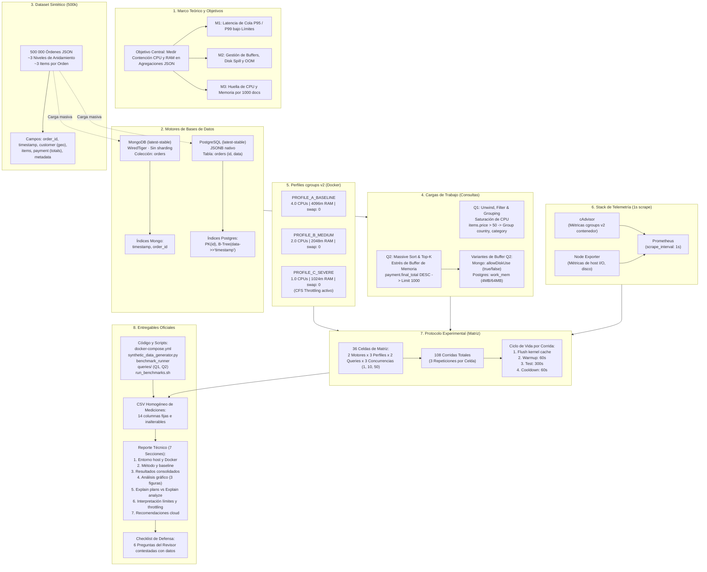

# ¿Qué Necesito para Empezar la Práctica EVA02?
## Guía de Preparación, Entorno Local y Grafo de Conocimiento

---

## 1. Explicación Corta (TL;DR — Inicio Rápido)

Para arrancar el proyecto de inmediato necesitas:

1. **Encender Docker Desktop:**
   * Abre la aplicación **Docker Desktop** en tu Windows y espera a que el icono se ponga en verde (*Engine running*).
   * Verifica en *Settings > General* que esté usando el motor **WSL 2 backend** (el cual ya incluye soporte nativo para **cgroups v2**).
2. **Entorno Python listo:**
   * Ya tienes instalado **Python 3.13.14**.
   * Solo instalaremos un entorno virtual (`venv`) con las librerías necesarias: `pymongo`, `psycopg2-binary` (o `asyncpg`), `requests`, `pandas`, `matplotlib`, `seaborn`.
3. **Flujo de Trabajo en 4 Pasos Clave:**
   * **Paso A:** Crear el `docker-compose.yml` con MongoDB, PostgreSQL y el stack de telemetría (Prometheus con scrape a 1s, cAdvisor y Node Exporter).
   * **Paso B:** Ejecutar el script generador para insertar los **500 000 documentos** estructurados en ambas bases con sus respectivos índices.
   * **Paso C:** Probar la **celda piloto** (MongoDB + Q1 + Concurrencia 1 en Baseline) para validar que el runner extraiga correctamente las métricas hacia el CSV estricto.
   * **Paso D:** Automatizar la matriz experimental de **36 celdas $\times$ 3 repeticiones (108 corridas)** y redactar el reporte de 7 secciones.

---

## 2. Explicación Larga y Detallada

### 2.1. Diagnóstico del Entorno Local Actual
Tras revisar tu máquina vía terminal, se detectó el siguiente estado:
- **Sistema Operativo:** Windows 11 (64-bit) con soporte WSL 2 (`docker-desktop`).
- **Docker CLI:** Versión `29.7.2` instalada. *(Estado actual: El servicio/daemon de Docker Desktop se encuentra detenido o apagado; es indispensable iniciarlo antes de levantar contenedores).*
- **Python:** Versión `3.13.14` instalada en el sistema.

---

### 2.2. Requisitos de Software y Configuración

#### A. Docker Desktop con cgroups v2
El experimento requiere medir el estrangulamiento de CPU (*CFS CPU Throttling*) y límites estrictos de memoria RAM mediante `cgroups v2`.
* **Configuración recomendada en Docker Desktop:**
  1. Abre **Docker Desktop**.
  2. Ve a **Settings (Engranaje) > Resources > Advanced / WSL 2**.
  3. Asegúrate de que Docker tenga asignado suficiente CPU (mínimo 4 CPUs físicos/lógicos) y al menos 6 GB - 8 GB de RAM asignada para que el perfil `PROFILE_A_BASELINE` (4 vCPUs y 4 GB RAM) opere sin asfixiar al sistema operativo anfitrión.
  4. Para verificar que Docker está corriendo bajo cgroups v2, ejecuta en la terminal una vez iniciado Docker:
     ```powershell
     docker info --format '{{.CgroupVersion}}'
     ```
     *Debe responder `2`.*

#### B. El reto de Windows / WSL2 y el comando `drop_caches`
El protocolo oficial exige:
```bash
sync; echo 3 > /proc/sys/vm/drop_caches
```
En Windows nativo (PowerShell) este comando no existe porque es una instrucción del kernel de Linux. Existen dos formas de resolverlo limpiamente:
1. **Opción Recomendada (Vía WSL2 / bash):** Ejecutar el script orquestador `run_benchmarks.sh` directamente dentro de una terminal WSL2 (Ubuntu / Debian) o desde un contenedor orquestador con privilegios de host (`privileged: true` o montando `/proc/sys/vm`).
2. **Alternativa vía PowerShell:** Invocar `wsl -u root sh -c "sync; echo 3 > /proc/sys/vm/drop_caches"`.

#### C. Dependencias de Python para Desarrollo y Análisis
Crearemos un entorno virtual en la raíz del proyecto:
```powershell
python -m venv .venv
.\.venv\Scripts\Activate.ps1
pip install pymongo psycopg2-binary requests pandas matplotlib seaborn
```

---

### 2.3. Mapa de Fases de Ejecución

```
[FASE 1: Infraestructura]  -->  [FASE 2: Generación 500k]  -->  [FASE 3: Consultas Q1/Q2]
docker-compose.yml              synthetic_data_generator.py      MQL & SQL probados
Prometheus + cAdvisor           Mongo + Postgres indexados        explain planes listos
        |
        v
[FASE 4: Celda Piloto]     -->  [FASE 5: Matriz 108 Corridas] --> [FASE 6: Reporte y Análisis]
1 motor, 1 query, conc 1        run_benchmarks.sh                 CSV completo, gráficas
Verificar columnas CSV          Flush + Warmup + Test + Cool      7 secciones obligatorias
```

1. **Fase 1: Infraestructura y Telemetría:**
   - Crear `docker-compose.yml` parametrizado con perfiles A (Baseline), B (Medium) y C (Severe).
   - Levantar Prometheus (`scrape_interval: 1s`), cAdvisor (métricas de contenedor cgroups v2) y Node Exporter.
2. **Fase 2: Generación e Inserción del Dataset de 500k:**
   - Crear `synthetic_data_generator.py`.
   - Generar datos sintéticos con 3 niveles de anidamiento y promedio de 3 items.
   - Insertar por lotes (*batch insert*) en MongoDB (`orders`) y PostgreSQL (`orders` con JSONB).
   - Crear los índices obligatorios (`timestamp` y `order_id`).
3. **Fase 3: Implementación de Consultas Analíticas:**
   - Guardar en `queries/` las consultas Q1 (unwind + group) y Q2 (sort masivo + top 1000).
   - Generar y guardar los planes de ejecución iniciales (`explain executionStats` y `EXPLAIN ANALYZE BUFFERS`).
4. **Fase 4: Validación de Celda Piloto:**
   - Probar el script de benchmarking en una sola celda.
   - Confirmar que se capturan `throughput_qps`, percentiles P50/P95/P99, `cpu_throttled_seconds`, `max_rss_mb`, `disk_spill` y `status`.
   - Verificar la coincidencia estricta con el esquema CSV oficial.
5. **Fase 5: Ejecución de la Matriz Completa:**
   - Ejecutar `run_benchmarks.sh` para las 36 celdas $\times$ 3 repeticiones (108 corridas).
   - Supervisar y registrar evidencias de volcado a disco y OOM.
6. **Fase 6: Redacción del Reporte Técnico:**
   - Procesar el CSV con Pandas para obtener medias/medianas.
   - Generar las 3 figuras obligatorias (P99 vs concurrencia, Throttling vs QPS, Curvas RSS).
   - Redactar las 7 secciones del reporte respondiendo las 6 preguntas del revisor.

---

## 3. Grafo de Conocimiento del Proyecto Completo

A continuación se muestra el grafo integral de relaciones del proyecto, conectando objetivos, motores, datasets, consultas, perfiles, telemetría, matriz y entregables:



---

## 4. Checklist Rápido de Validación Pre-Arranque

- [ ] Iniciar la aplicación **Docker Desktop** en Windows.
- [ ] Confirmar que el motor Docker responde ejecutando `docker ps`.
- [ ] Verificar que Docker soporte cgroups v2 ejecutando `docker info | Select-String -Pattern "Cgroup"`.
- [ ] Crear el entorno virtual de Python e instalar librerías cliente.
- [ ] Revisar el documento complementario [`ENTREGABLES.md`](file:///c:/Users/luisn/OneDrive/Escritorio/Tareas/BD/2026.C3.EVA02/contexto/ENTREGABLES.md) para no descuidar ninguna especificación de entrega.
